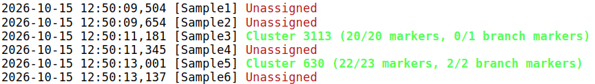
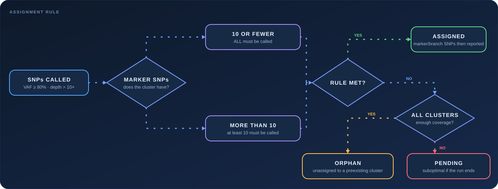
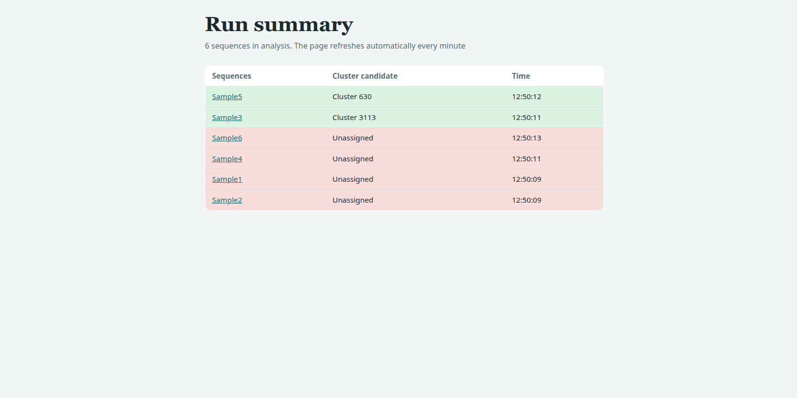
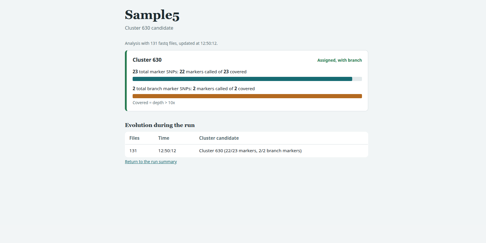
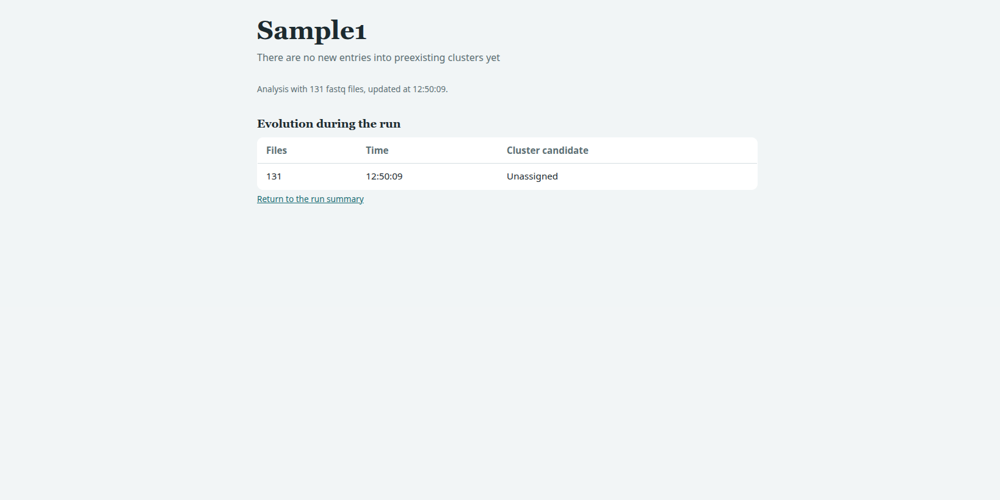

# RT-TBCluster: real-time tracking of tuberculosis transmission clusters

**RT-TBCluster** follows a _Mycobacterium tuberculosis_ sequencing run **while it is still running** and tells you, sample by sample, whether each new case belongs to a known transmission cluster. It works with Oxford Nanopore sequencers, and it produces simple web pages (HTML reports) that update by themselves every minute.

> **In one sentence:** you start the sequencer, you start RT-TBCluster, and within minutes you can already see which samples are linked to known outbreaks, instead of waiting until the run has finished.

---

## Table of contents

1. [What is this and who is it for?](#1-what-is-this-and-who-is-it-for)
2. [The idea in plain words](#2-the-idea-in-plain-words)
3. [Workflow](#3-workflow)
4. [Glossary: the words you will see](#4-glossary-the-words-you-will-see)
5. [What you need before starting](#5-what-you-need-before-starting)
6. [Installation](#6-installation)
7. [How to run it](#7-how-to-run-it)
8. [All the options](#8-all-the-options)
9. [How a sample is assigned to a cluster](#9-how-a-sample-is-assigned-to-a-cluster)
10. [How to read the results](#10-how-to-read-the-results)
11. [What is written to disk](#11-what-is-written-to-disk)
12. [Stopping, restarting and safety](#12-stopping-restarting-and-safety)
13. [Troubleshooting](#13-troubleshooting)
14. [Limitations](#14-limitations)
15. [Citation](#15-citation)
16. [License](#16-license)
17. [Acknowledgements](#17-acknowledgements)

---

## 1. What is this and who is it for?

Tuberculosis (TB) spreads from person to person, and public health teams group cases that are genetically very similar into **transmission clusters**. Knowing early that a new patient belongs to an existing cluster can change how quickly contact tracing and control measures are started.

Sequencing the bacteria's DNA is the most precise way to know this, and **Oxford Nanopore** sequencers produce data continuously, from the first minutes of a run. RT-TBCluster takes advantage of that: it analyses the data **as it is generated** and gives a preliminary answer for every sample long before the run ends.

RT-TBCluster is designed for:

- **Public health and clinical microbiology laboratories** that already sequence TB with Nanopore and want fast answers.
- **Epidemiologists and clinicians** who want to read the results without any programming: the output is a web page.
- **Bioinformaticians** who want an automated, resumable real-time pipeline.

You do **not** need to understand how the analysis works to read the reports. Section 10 explains them step by step.

## 2. The idea in plain words

Imagine each known cluster has a few **fingerprint positions** (markers) in the TB genome: places where the bacteria of that cluster carry a specific change (a _SNP_) that other bacteria do not have. RT-TBCluster does the following, again and again, while the sequencer runs:

1. **Looks for new data** produced by the sequencer for each sample.
2. **Aligns** the new DNA reads to a reference TB genome (like placing puzzle pieces on the picture of the finished puzzle).
3. **Finds the differences** between the sample and the reference.
4. **Compares** those differences with the fingerprint positions of every known cluster.
5. **Decides** whether the sample carries enough fingerprints of a cluster to be assigned to it.
6. **Checks how much data it has** at each fingerprint position, to know whether a missing fingerprint is truly absent or simply not sequenced yet.
7. **Updates the reports** and waits for more data.

When no new data has arrived for one hour, it understands that the run has finished and stops.

## 3. Workflow

This is the full path of the data, from the run folder to the reports. The cycle repeats until the run ends.

<p align="center">
  
</p>

<p align="center"><em>In the animated diagram, the white dots travel around the loop and each step lights up when it is its turn.</em></p>

The important point is step 2: **only the new reads are aligned** and then added to the ones already analysed. The whole run is never re-aligned from scratch, which keeps every cycle fast.

## 4. Glossary: the words you will see

| Term                       | What it means                                                                                                                                           |
| -------------------------- | ------------------------------------------------------------------------------------------------------------------------------------------------------- |
| **Nanopore**               | A sequencing technology that reads DNA in real time and saves the reads in small files as the run progresses.                                           |
| **Barcode**                | A short DNA tag added to each sample so that many samples can be sequenced together in the same run. Each sample ends up in its own `barcodeXX` folder. |
| **FASTQ**                  | The file format with the raw DNA reads and their quality.                                                                                               |
| **Reference genome**       | The "picture of the finished puzzle": a known TB genome used to place the reads.                                                                        |
| **Mapping / alignment**    | Placing each read at its position in the reference genome. The result is stored in a **BAM** file.                                                      |
| **SNP**                    | A single-letter change in the DNA compared with the reference (for example, a C where the reference has a T).                                           |
| **Variant calling**        | The step that finds the differences (SNPs, insertions, deletions) between a sample and the reference.                                                   |
| **Depth (coverage)**       | How many reads cover a position. More reads means a more reliable answer.                                                                               |
| **Allele frequency (VAF)** | The proportion of reads at a position that show the change. 100% means all reads agree.                                                                 |
| **Transmission cluster**   | A group of cases whose bacteria are genetically almost identical, suggesting recent transmission.                                                       |
| **Marker SNP**             | A SNP that is characteristic of a cluster. Carrying enough of them places a sample in that cluster.                                                     |
| **Branch SNP**             | A SNP that belongs to a specific branch inside the cluster's genomic network. It refines the position of the sample _within_ the cluster.               |
| **Called**                 | A SNP is _called_ when it was found in the sample with enough frequency and depth.                                                                      |
| **Covered**                | A position is _covered_ when it has enough depth to be trusted, whether or not it carries the change.                                                   |
| **Assigned / Unassigned**  | Whether the sample has been placed in a known cluster or not (yet).                                                                                     |

## 5. What you need before starting

### 5.1 The Nanopore run folder

This is the folder that the sequencer software creates. RT-TBCluster only needs the `fastq_pass` folders, which it finds on its own wherever they are:

```
Run_folder/
└── no_sample_id/
    └── Date_FlowCellID/
        ├── fastq_pass/
        │   ├── barcode01/    <- FASTQ files of one sample, arriving over time
        │   ├── barcode02/
        │   └── ...
        └── (other files that RT-TBCluster ignores)
```

This folder is **only read, never modified**. RT-TBCluster refuses to start if your output folder is inside it.

### 5.2 A table of barcodes and sample names

A plain text file with two columns separated by a **tab**: the barcode and the real name of the sample. Barcodes can be written as `barcode01`, `01` or `1`. Lines that start with `#` are ignored. Only the barcodes listed here are analysed.

```
barcode01	SAMPLE_A
02	SAMPLE_B
3	SAMPLE_C
```

### 5.3 A reference genome

A FASTA file with the TB reference genome used to map the reads (for example, the _M. tuberculosis_ ancestor II reference).

### 5.4 The cluster catalogue

A tab-separated file that lists, for every known cluster, its fingerprint positions. The header must be exactly:

```
#CHROM	POS	ID	REF	ALT	QUAL	FILTER	FORMAT	INFO
```

The last column, `INFO`, says what each position is: `Marker-<cluster>` for a marker SNP, or `Branch-<cluster>` for a branch SNP. For example:

```
#CHROM	POS	ID	REF	ALT	QUAL	FILTER	FORMAT	INFO
MTB_ancestorII	1234	.	C	T	.	.	.	Marker-15
MTB_ancestorII	5678	.	G	A	.	.	.	Marker-15
MTB_ancestorII	9012	.	T	C	.	.	.	Branch-15
```

Here, positions 1234 and 5678 are marker SNPs of cluster **15**, and position 9012 is a branch SNP of cluster 15. The name in the first column (`#CHROM`) **must be identical** to the name of the sequence in the reference FASTA.

## 6. Installation

RT-TBCluster is a Python script that uses several well-known bioinformatics programs. The easiest way to install them is with [conda](https://docs.conda.io/):

```bash
conda create -n tbrt python=3.8 pandas minimap2 ngmlr samtools bcftools freebayes snippy
conda activate tbrt
git clone https://github.com/MG-IiSGM/RT-TBCluster.git
cd RT-TBCluster
```

Programs used:

| Program                                             | What it does in RT-TBCluster                                     |
| --------------------------------------------------- | ---------------------------------------------------------------- |
| [minimap2](https://github.com/lh3/minimap2)         | Aligns the reads to the reference (standard mode).               |
| [NGMLR](https://github.com/philres/ngmlr)           | Aligns the reads when working with amplicon data (`--amplicon`). |
| [SAMtools](https://github.com/samtools/samtools)    | Sorts, merges and indexes alignments, and measures depth.        |
| [FreeBayes](https://github.com/freebayes/freebayes) | Finds the variants.                                              |
| [BCFtools](https://github.com/samtools/bcftools)    | Filters the variants.                                            |
| [Snippy](https://github.com/tseemann/snippy)        | Splits complex variants into simple SNPs.                        |
| [pandas](https://pandas.pydata.org/)                | Handles the tables.                                              |

## 7. How to run it

```bash
python realtime_cluster.py \
    -i /data/Run_folder \
    -s barcodes.tsv \
    -r reference.fasta \
    -c clusters.tsv \
    -o Results \
    -t 32
```

| Option | Meaning                                          |
| ------ | ------------------------------------------------ |
| `-i`   | The Nanopore run folder (read only).             |
| `-s`   | The table of barcodes and sample names.          |
| `-r`   | The reference genome.                            |
| `-c`   | The cluster catalogue.                           |
| `-o`   | The folder where **everything** will be written. |
| `-t`   | Number of CPU threads to use.                    |

Start it **at the same time as the sequencing run**, or at any moment during it. If the run takes hours, we recommend launching it inside `screen` or `tmux`, so it keeps running if you close the terminal.

While it runs, the terminal prints one line per sample after each analysis: in **bold green** when the sample is assigned to a cluster and in **red** when it is unassigned.



To follow the results, open `Results/reports/Summary.html` in any web browser. It refreshes itself every minute.

## 8. All the options

| Option                   | Default  | Meaning                                                                                                                  |
| ------------------------ | -------- | ------------------------------------------------------------------------------------------------------------------------ |
| `-i`, `--input`          | required | Nanopore run folder (read only).                                                                                         |
| `-s`, `--samples`        | required | Table with barcode and sample name.                                                                                      |
| `-r`, `--reference`      | required | Reference genome in FASTA format.                                                                                        |
| `-c`, `--clusters`       | required | Cluster catalogue with `Marker-X` / `Branch-X` in `INFO`.                                                                |
| `-o`, `--output`         | required | Output folder. It cannot be inside the run folder.                                                                       |
| `-t`, `--threads`        | 8        | Number of CPU threads.                                                                                                   |
| `--amplicon`             | off      | Use it for amplicon sequencing data (aligns with NGMLR).                                                                 |
| `--annot_min_freq`       | 0.8      | Minimum allele frequency for a SNP to be _called_ (equal or greater).                                                    |
| `--annot_min_dp`         | 10       | Depth that a SNP or position must **exceed** to be _called_ or _covered_.                                                |
| `--min_allele_frequency` | 0.1      | Minimum frequency for the first, more permissive, detection of variants.                                                 |
| `--min_quality`          | 12       | Minimum base quality.                                                                                                    |
| `--min_mapping`          | 60       | Minimum mapping quality.                                                                                                 |
| `--ploidy`               | 1        | Ploidy of the organism (bacteria: 1).                                                                                    |
| `--poll`                 | 60       | Seconds to wait between checks for new files.                                                                            |
| `--settle`               | 30       | A file is used only after it has not changed for this many seconds, to avoid reading files that are still being written. |
| `--idle_timeout`         | 3600     | The analysis stops after this many seconds without new files.                                                            |

## 9. How a sample is assigned to a cluster

A SNP counts as **called** only if it passes both requirements: **allele frequency of at least 80%** and **depth above 10 reads**. Then, for each cluster, the rule is:

<p align="center">
  
</p>

Two examples:

- **Cluster 15 has 9 marker SNPs.** Since 9 is less than 10, a sample needs all 9 to be assigned.
- **Cluster 113 has 27 marker SNPs.** Since there are more than 10, a sample needs at least 10 of the 27.

Once a sample is assigned, the **branch SNPs** that it carries are reported to place it more precisely within the genomic network of the cluster. Branch SNPs do not decide the assignment, they only refine it.

> **Important:** this is a **preliminary, real-time assignment**. It can change as more data arrives, and it should be confirmed with the standard analysis of the complete run, once it has finished.

## 10. How to read the results

All reports are web pages in `Results/reports/`. Open them in any browser.

### 10.1 The run summary: `Summary.html`

One row per sample. The colour tells you the result at a glance:

- **Green row:** the sample is assigned to a cluster (the cluster is written in the row).
- **Red row:** the sample is unassigned.

The page refreshes every minute, so you can leave it open during the whole run. Click on a sample name to open its individual report.



### 10.2 Individual report of a sample assigned to a cluster

At the top, you find the sample name and, below it, the candidate cluster. Then there is one card per cluster, with two bars:

- **Marker SNPs** (teal bar): _"27 total marker SNPs: 24 markers called of 27 covered"_.
- **Branch marker SNPs** (orange bar): the same, for the branch SNPs.

How to read each line:

- **Total** is how many fingerprint positions the cluster has in the catalogue.
- **Covered** is in how many of them the sample has enough data (depth above the threshold) to be trusted.
- **Called** is in how many of them the sample actually carries the cluster's variant.
- **The coloured bar** shows _called_ out of _total_.

Why does _covered_ matter? A fingerprint that is **covered but not called** means that the sample really does not carry it. A fingerprint that is **not covered** means that we do not know yet, so the answer may change if you keep sequencing. This is how you can tell a true absence from a lack of data.

Below the cards, **Evolution during the run** is a table showing how the result changed as more files were analysed.



### 10.3 Individual report of an unassigned sample

The header states **"No candidate cluster assigned"**, and the evolution table shows the result at each moment. It simply means that, with the data available so far, the sample does not carry enough fingerprints of any known cluster. If the run is still going, it may change.



## 11. What is written to disk

Everything goes to the folder you chose with `-o`:

```
Results/
├── state.json                       <- Memory of the analysis (lets you restart)
├── reports/
│   ├── Summary.html                 <- Run summary
│   └── SAMPLE_A.html                <- One report per sample
└── samples/
    └── SAMPLE_A/
        ├── current/                 <- Latest cumulative alignment (BAM) and reads (FASTQ)
        └── SAMPLE_A-141/            <- Results of the analysis with 141 files
            ├── variants/            <- Variant files (VCF and tables)
            ├── SAMPLE_A-141.annotated.tsv   <- Every variant, labelled Marker-X / Branch-X
            ├── cluster_positions.bed        <- Cluster positions that were checked
            └── cluster_positions.depth      <- Depth at each of those positions
```

The number after the sample name (`-141`) is **how many FASTQ files** had been analysed at that moment. Each cycle creates a new folder, so you can follow the history of the analysis. To save disk space, only the latest alignment and reads are kept in `current/`.

## 12. Stopping, restarting and safety

- **Your sequencing data is safe.** RT-TBCluster never writes inside the run folder.
- **It stops by itself** after one hour without new files (change it with `--idle_timeout`). You can also stop it at any time with `Ctrl + C`.
- **You can restart it.** The file `state.json` remembers which files were already analysed. If you launch the same command again with the same output folder, it continues from where it stopped, and only processes the new files.
- **Do not run two copies at the same time** with the same output folder, because they would overwrite each other's files.
- If you stop the program while a sample is being analysed, delete the folder `samples/<sample>/<sample>-N/` of that last step before restarting, to avoid using an incomplete file.

## 13. Troubleshooting

| Message or problem                            | Probable cause and solution                                                                                                                                           |
| --------------------------------------------- | --------------------------------------------------------------------------------------------------------------------------------------------------------------------- |
| `-o cannot be inside -i`                      | The output folder is inside the run folder. Choose another folder.                                                                                                    |
| `There is not barcodeXX yet (fastq_pass)`     | That barcode has not produced files yet, or the name in your table is wrong. It is only a warning: RT-TBCluster will keep looking.                                    |
| `samtools depth did not return any positions` | The name in the first column of the cluster file does not match the name of the sequence in the reference. Check it with `samtools view -H file.bam \| grep @SQ`.     |
| `The cumulative BAM ... is missing`           | A previous run was interrupted and some files were removed. Delete that sample's entry in `state.json` and its folder in `samples/` to analyse it again from scratch. |
| Every sample is "Unassigned" at the beginning | Normal: not enough data has been sequenced yet. Wait and watch how the result evolves.                                                                                |
| The reports do not update                     | Reload the page. The reports only change when new files have been analysed.                                                                                           |
| A column of the catalogue is not found        | Check that the header is exactly the one in section 5.4, with tabs between columns.                                                                                   |

## 14. Limitations

- The assignment is **preliminary**: it uses the data produced up to that moment, and must be confirmed with the complete analysis.
- Samples with low DNA, low quality or few reads will take longer to reach enough depth, or may never do it.
- It only recognises the clusters that are in your catalogue. A sample that does not belong to any of them will show as unassigned, even if it is part of a new outbreak.
- This tool supports, but does not replace, the interpretation of the epidemiologist and the standard laboratory procedures. It has not been certified for clinical diagnosis.

## 15. Citation

If you use RT-TBCluster in your work, please cite:

> [Authors]. [Title of the article]. [Journal], [Year]. [DOI]

## 16. License

This project is released under the **GPL-3.0 license** license. See the [LICENSE](LICENSE) file for details.

## 17. Acknowledgements

This software was developed with the assistance of an artificial intelligence model, **Claude** (Anthropic), which helped to write parts of the code and of this documentation. The authors defined the scientific methodology, reviewed, tested and validated the code, and take full responsibility for the software and its results.

RT-TBCluster builds on the work of the developers of minimap2, NGMLR, SAMtools, BCFtools, FreeBayes and Snippy.

---

**Questions or suggestions?** Open an [issue](../../issues) in this repository or contact [name / email].
